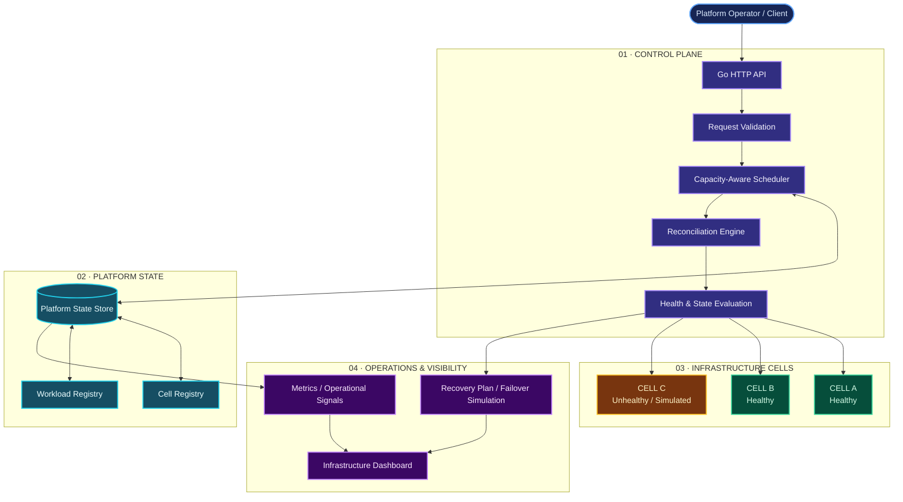
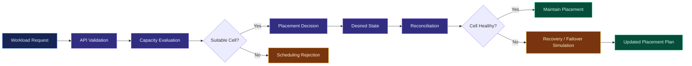

# ◈ CELLFORGE X
### ADVANCED MULTI-CLUSTER KUBERNETES PLATFORM CONTROL PLANE

<p align="center">
  <strong>ENGINEERING RESILIENT INFRASTRUCTURE THROUGH INTELLIGENT ORCHESTRATION.</strong>
</p>

<p align="center">
  <a href="https://github.com/akankshad1712/cellforge-x-multi-cluster-platform">
    
  </a>
  
  
  
</p>

<p align="center">
  <a href="#-overview">Overview</a> •
  <a href="#-architecture">Architecture</a> •
  <a href="#-capabilities">Capabilities</a> •
  <a href="#-technology-stack">Tech Stack</a> •
  <a href="#-getting-started">Getting Started</a> •
  <a href="#-roadmap">Roadmap</a>
</p>

---

## ◈ 01 — THE VISION

**What if infrastructure could detect instability, isolate failures, and continuously work toward the desired state?**

CELLFORGE X is a Go-based platform-engineering prototype exploring the architecture of a cell-based, multi-cluster Kubernetes control plane.

It focuses on the engineering principles behind infrastructure orchestration:

- Capacity-aware workload placement.
- Cell-based infrastructure organization.
- Desired-state reconciliation.
- Failure isolation and recovery simulation.
- Operational visibility.
- Automated build and deployment workflows.

The central design principle is simple:

> A failure in one infrastructure cell should not automatically become a failure across the entire platform.

CELLFORGE X explores how that principle can influence the design of modern cloud-native platforms.

## ✦ 02 — PLATFORM AT A GLANCE

| Dimension | Description |
|---|---|
| Project | CELLFORGE X |
| Category | Platform Engineering |
| Architecture | Cell-based control-plane prototype |
| Primary language | Go |
| Interface | HTTP API |
| Scheduling | Capacity-aware placement |
| Recovery | Reconciliation and failover simulation |
| Deployment assets | Docker and Kubernetes manifests |
| Automation | GitHub Actions |
| Visualization | Infrastructure dashboard concept |

## ◈ 03 — SYSTEM ARCHITECTURE

The architecture separates incoming workload requests, placement decisions, infrastructure state, and recovery planning.

### High-level architecture



### Architectural layers

| Layer | Responsibility |
|---|---|
| API layer | Accepts and processes platform requests |
| Scheduling layer | Evaluates capacity and workload placement |
| State layer | Maintains platform and workload state |
| Reconciliation layer | Evaluates desired and observed state |
| Cell layer | Represents isolated infrastructure units |
| Operations layer | Provides visibility and recovery information |

*Note: The infrastructure cells in this prototype represent the platform's modeled environment. They are not proof of live Kubernetes clusters being controlled.*

## ✦ 04 — CORE ENGINEERING CAPABILITIES

### 01. Control-plane API

A Go HTTP API that provides the entry point for interacting with platform functionality.

**Engineering focus:**
- Request handling.
- Platform operations.
- Workload and cell state.
- API-level infrastructure management.

### 02. Capacity-aware scheduling

A scheduler that evaluates infrastructure capacity when selecting workload placement targets.

**Engineering focus:**
- Resource-aware placement.
- Capacity constraints.
- Cell selection.
- Scheduling decisions.

### 03. Reconciliation engine

A control-plane pattern that compares desired and observed platform state to identify required corrective actions.

**Engineering focus:**
- State comparison.
- Reconciliation planning.
- Consistent platform behavior.
- Recovery-oriented workflows.

### 04. Failure isolation and failover simulation

Explores how an unhealthy cell can affect workload availability and how recovery decisions can be represented.

**Engineering focus:**
- Cell health evaluation.
- Failure scenarios.
- Recovery planning.
- Blast-radius awareness.

### 05. Observability and dashboard

A dashboard concept for presenting platform information in a modern infrastructure-oriented interface.

**Engineering focus:**
- Operational visibility.
- Infrastructure status.
- Workload overview.
- Metrics presentation.

### 06. Infrastructure automation

The repository includes containerization, Kubernetes deployment assets, and a CI workflow.

**Engineering focus:**
- Docker packaging.
- Kubernetes deployment configuration.
- GitHub Actions automation.
- Repeatable development workflows.

## ◈ 05 — TECHNOLOGY STACK

| Technology | Purpose |
|---|---|
| Go | Control-plane implementation |
| HTTP / REST concepts | API communication |
| Kubernetes | Infrastructure architecture and deployment concepts |
| Docker | Container packaging |
| YAML | Infrastructure configuration |
| GitHub Actions | CI workflow |
| HTML / CSS / JavaScript | Dashboard interface |
| Prometheus-format metrics | Metrics-oriented observability, where implemented |

<p align="center">
  
</p>

## ✦ 06 — REPOSITORY STRUCTURE

```text
cellforge-x-multi-cluster-platform/
│
├── .github/
│   └── workflows/
│       └── ci.yml
│
├── cmd/
│   └── controlplane/
│       └── main.go
│
├── deploy/
│   └── kubernetes/
│       └── deployment.yaml
│
├── docs/
│   ├── API.md
│   ├── ARCHITECTURE.md
│   ├── RUNBOOK.md
│   └── architecture.svg
│
├── internal/
│   └── platform/
│       ├── api.go
│       ├── model.go
│       ├── scheduler.go
│       ├── store.go
│       └── platform_test.go
│
├── scripts/
│   └── demo.sh
│
├── web/
│   └── dashboard.html
│
├── .dockerignore
├── Dockerfile
├── LICENSE
├── Makefile
├── README.md
└── go.mod
```

### Code organization

| Directory | Engineering responsibility |
|---|---|
| `cmd/controlplane` | Application entry point |
| `internal/platform` | Core platform logic |
| `deploy/kubernetes` | Kubernetes deployment assets |
| `docs` | Architecture, API and operational documentation |
| `scripts` | Demo and helper scripts |
| `web` | Dashboard concept |
| `.github/workflows` | CI automation |

## ◈ 07 — GETTING STARTED

### Prerequisites

- Go installed.
- Git installed.
- Visual Studio Code or another Go-compatible editor.

### Clone the repository

```bash
git clone https://github.com/akankshad1712/cellforge-x-multi-cluster-platform.git

cd cellforge-x-multi-cluster-platform
```

### Download dependencies

```bash
go mod download
```

### Run tests

```bash
go test ./... -race -cover
```

### Start the control plane

```bash
go run ./cmd/controlplane
```

### Explore the dashboard

Open:

```text
web/dashboard.html
```

You can open this file directly in your browser.

## ✦ 08 — ENGINEERING WORKFLOW



This workflow illustrates the platform's intended control-plane behavior; it does not imply that every step performs a live Kubernetes operation.

## ◈ 09 — RELIABILITY & DESIGN PRINCIPLES

| Principle | Design objective |
|---|---|
| Failure isolation | Limit the impact of unhealthy infrastructure |
| Capacity awareness | Avoid unsuitable workload placement |
| Reconciliation | Continuously reason about platform state |
| Modularity | Separate API, scheduling, and state responsibilities |
| Observability | Make infrastructure behavior easier to understand |
| Automation | Reduce repetitive build and deployment work |

## ✦ 10 — PROJECT MATURITY

CELLFORGE X is an engineering prototype, not a production-ready multi-cluster Kubernetes platform.

| Capability | Current scope |
|---|---|
| Go control-plane API | Implemented |
| Capacity-aware scheduler | Implemented |
| Platform state model | Implemented |
| Reconciliation / recovery behavior | Prototype and simulation |
| Cell-based infrastructure model | Modeled |
| Dashboard concept | Included |
| Dockerfile | Included |
| Kubernetes deployment manifest | Included |
| GitHub Actions workflow | Included |
| Live multi-cluster Kubernetes integration | Future work |
| Persistent distributed state | Future work |
| Distributed leader election | Future work |
| Production AWS / GCP adapters | Future work |
| Production authentication and authorization | Future work |

## ◈ 11 — ROADMAP

The following are potential engineering extensions, not claims of completed functionality.

- [ ] Integrate real Kubernetes clusters using `client-go` or `controller-runtime`.
- [ ] Introduce PostgreSQL-backed persistent state.
- [ ] Implement Kubernetes Lease-based leader election.
- [ ] Add topology-aware scheduling and affinity policies.
- [ ] Build AWS and GCP infrastructure adapters.
- [ ] Add OpenTelemetry distributed tracing.
- [ ] Expand Prometheus metrics and Grafana dashboards.
- [ ] Introduce chaos testing and fault injection.
- [ ] Add authentication, authorization, and audit logging.
- [ ] Validate recovery behavior through integration and load tests.

## ✦ 12 — CONTRIBUTING

Contributions, suggestions, and engineering discussions are welcome.

1. Fork the repository.
2. Create a feature branch.
3. Make your changes.
4. Run the Go test suite.
5. Submit a pull request with a clear explanation.

```bash
git checkout -b feature/your-feature
git add .
git commit -m "feat: describe your improvement"
git push origin feature/your-feature
```

## ◈ 13 — PROJECT AUTHOR

<p align="center">
  <strong>AKANKSHA DESHMUKH</strong>
  <br>
  Platform Engineering • Cloud-Native Systems • Software Engineering
</p>

<p align="center">
  <a href="https://github.com/akankshad1712">
    
  </a>
  <a href="https://www.linkedin.com/in/akanksha-deshmukh-26210b244/">
    
  </a>
</p>

**Interested in:** Platform Engineering · Kubernetes · Go · Distributed Systems · Cloud Infrastructure · Reliability Engineering

---

<p align="center">
  <strong>CELLFORGE X</strong>
  <br>
  <em>Beyond cluster management. Toward intelligent infrastructure orchestration.</em>
  <br><br>
  <sub>Built to explore the engineering principles behind resilient cloud-native platforms.</sub>
</p>
