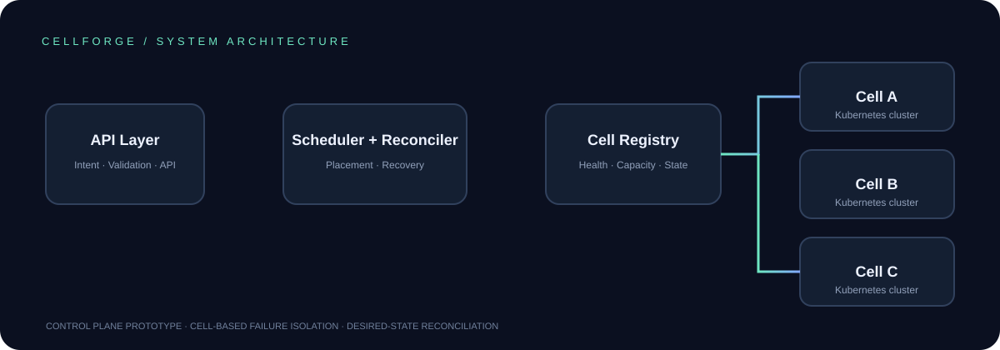
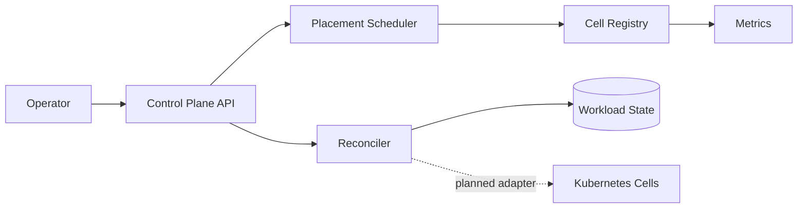

# CELLFORGE — Cell-Based Infrastructure Control Plane

**Designing for failure domains, not just uptime.**

CELLFORGE is a Go-based platform-engineering prototype that models a cell-oriented control plane. It registers independent infrastructure cells, places workloads using health and capacity constraints, and reconciles pending or disrupted workloads after a simulated cell incident.

> This repository is a portfolio prototype, not a production Kubernetes control plane. The current adapter is an in-memory simulation. The Kubernetes integration, persistence, multi-replica coordination and security roadmap are documented as future work.

## Why this problem matters

A shared infrastructure failure can affect unrelated services. Cell-based architecture aims to reduce correlated failures by dividing infrastructure into bounded failure domains. A platform control plane needs to understand cell health, available capacity, workload intent and safe recovery behavior.

## Architecture





See [architecture notes](docs/ARCHITECTURE.md), [API reference](docs/API.md), and [incident runbook](docs/RUNBOOK.md).

## Implemented capabilities

| Capability | Current implementation | Engineering relevance |
|---|---|---|
| Cell inventory | Region, cluster, capacity and health | Failure-domain modelling |
| Placement | Deterministic best-fit among healthy cells | Capacity-aware scheduling |
| Reconciliation | Pending/disrupted workload retry | Desired-state control loop |
| Failure simulation | Mark a cell offline and retry placement | Recovery workflow |
| Observability | Health/readiness endpoints and Prometheus text metrics | Operational visibility |
| API validation | Strict JSON fields and bounded request bodies | Predictable API behavior |
| Concurrency | Mutex-protected in-memory state | Race-safe single-process mutation |

## Quick start

Requirements: Go 1.22+

```bash
go test ./... -race -cover
go run ./cmd/controlplane
```

API base: `http://localhost:8080`

### Register cells

```bash
curl -X POST localhost:8080/v1/cells -H 'Content-Type: application/json' \\
  -d '{"id":"ap-south-a","region":"ap-south-1","cluster":"cluster-a","capacity":10}'

curl -X POST localhost:8080/v1/cells -H 'Content-Type: application/json' \\
  -d '{"id":"ap-south-b","region":"ap-south-1","cluster":"cluster-b","capacity":6}'
```

### Submit and place a workload

```bash
curl -X POST localhost:8080/v1/workloads -H 'Content-Type: application/json' \\
  -d '{"id":"checkout","name":"checkout-api","replicas":3}'
curl -X POST localhost:8080/v1/reconcile
curl localhost:8080/v1/workloads
```

### Simulate a cell incident

Use the actual assigned `cellId` from the workload response:

```bash
curl -X POST localhost:8080/v1/cells/ap-south-a/state \\
  -H 'Content-Type: application/json' -d '{"state":"offline"}'
curl -X POST localhost:8080/v1/reconcile
```

If another healthy cell has capacity, the controller re-places the disrupted workload. If not, it remains disrupted rather than exceeding capacity.

## API endpoints

| Method | Endpoint | Description |
|---|---|---|
| GET | `/healthz` | Liveness |
| GET | `/readyz` | Readiness |
| GET | `/metrics` | Prometheus text metrics |
| GET | `/v1/cells` | List cells |
| POST | `/v1/cells` | Register cell |
| POST | `/v1/cells/{id}/state` | Change simulated cell health |
| GET | `/v1/workloads` | List workloads |
| POST | `/v1/workloads` | Create workload intent |
| POST | `/v1/reconcile` | Reconcile desired state |

## Repository structure

```text
cellforge/
├── cmd/controlplane/       # Service entry point
├── internal/platform/     # Domain model, store, scheduler and API
├── deploy/kubernetes/     # Hardened starter Deployment and Service
├── docs/                  # Architecture, API and runbook
├── web/                   # Static concept dashboard
├── scripts/               # Local demo helper
├── .github/workflows/     # CI checks
├── Dockerfile
└── Makefile
```

## Dashboard concept

Open [`web/dashboard.html`](web/dashboard.html) in a browser. It is a static design mockup with illustrative values, not a live dashboard connected to the API.

## Engineering trade-offs and next steps

1. Replace in-memory state with durable storage and optimistic concurrency.
2. Add Kubernetes `client-go` adapters and CRDs for cell and workload intent.
3. Add leader election or partitioned work queues before running multiple controllers.
4. Add topology spread, anti-affinity, quotas, workload priorities and data-locality constraints.
5. Add retry budgets, backoff, disruption limits and health-signal hysteresis.
6. Add OpenTelemetry traces, Prometheus alert rules and Grafana dashboards.
7. Add authentication, RBAC, audit logging, TLS and admission controls.
8. Validate with Kind integration tests and controlled failure/chaos experiments.

## Resume wording — only after you have run and verified it

**CELLFORGE — Cell-Based Infrastructure Control Plane | Go, Kubernetes concepts, Docker, Linux, REST, Prometheus**

- Built a cell-oriented control-plane prototype modelling independent infrastructure failure domains and capacity-aware workload placement.
- Implemented deterministic best-fit scheduling and desired-state reconciliation to re-place workloads after simulated cell failures.
- Exposed operational health endpoints and Prometheus-format metrics, with race-enabled tests covering placement, failover and API validation.

Do not claim production Kubernetes orchestration, multi-cloud deployment, a real autoscaler, or measured availability until those features exist and have been tested.

## License

MIT. See [LICENSE](LICENSE).
