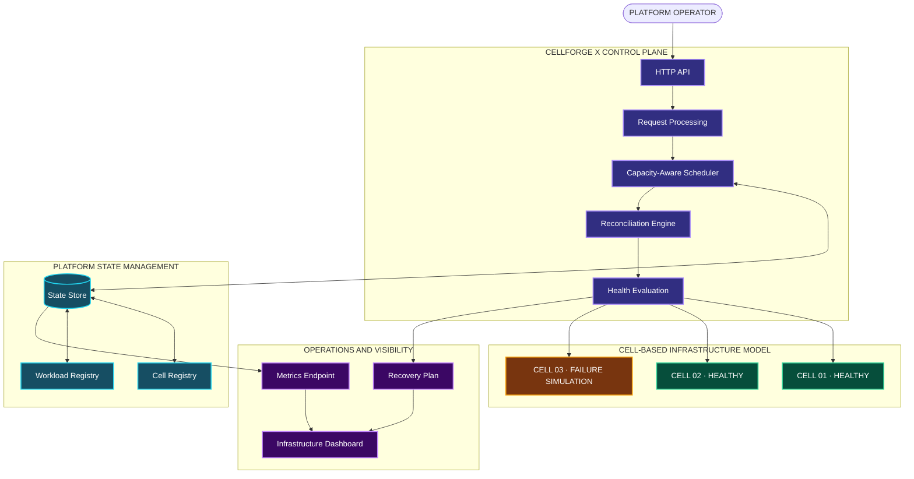
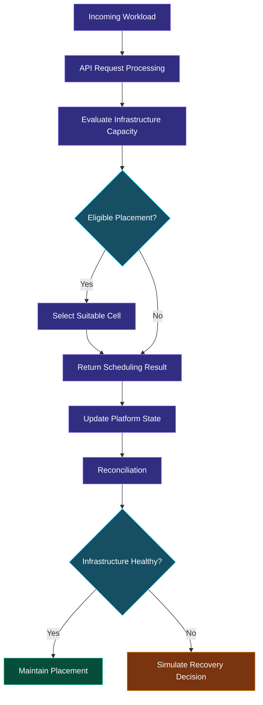

# CELLFORGE X
### MULTI-CLUSTER KUBERNETES PLATFORM CONTROL PLANE

<div align="center">

**INTELLIGENT ORCHESTRATION. RESILIENT INFRASTRUCTURE. CONTROLLED COMPLEXITY.**

A Go-based platform engineering system demonstrating cell-based infrastructure modeling, capacity-aware workload scheduling, reconciliation, failure simulation, and operational visibility.

[](https://go.dev/)
[](https://kubernetes.io/)
[](https://www.docker.com/)
[](#)
[](https://github.com/features/actions)

**[GitHub Repository](https://github.com/akankshad1712/cellforge-x-multi-cluster-platform) · [Architecture](docs/ARCHITECTURE.md) · [API](docs/API.md) · [Runbook](docs/RUNBOOK.md)**

</div>

---

## 01 — THE PLATFORM

CELLFORGE X is a control-plane engineering prototype built around a central infrastructure challenge:

**How can a platform make intelligent workload placement decisions while maintaining visibility into infrastructure health and recovery behavior?**

The system models infrastructure as independent cells and provides a Go-based control plane for platform operations.

It brings together workload scheduling, infrastructure state management, reconciliation logic, recovery simulation, API operations, and a visual dashboard.

### Platform characteristics

| Characteristic | Implementation |
|---|---|
| Control-plane application | Go |
| API interface | HTTP |
| Infrastructure organization | Cell-based model |
| Workload placement | Capacity-aware scheduler |
| State management | Platform state store |
| Recovery behavior | Reconciliation and failover simulation |
| Infrastructure visualization | Dashboard |
| Deployment packaging | Docker |
| Deployment configuration | Kubernetes YAML |
| Automation | GitHub Actions |

## 02 — SYSTEM ARCHITECTURE



*The cell topology illustrates the modeled infrastructure architecture, not live connections to separate Kubernetes clusters.*

## 03 — CORE PLATFORM MODULES

### Control-plane API

The central entry point for platform operations.

- HTTP request handling.
- Platform resource operations.
- Workload and cell interactions.
- Structured application behavior.

### Capacity-aware scheduler

The scheduling module evaluates available infrastructure capacity before selecting workload placement.

- Capacity evaluation.
- Placement eligibility.
- Infrastructure selection.
- Scheduling decisions.

### Platform state management

The platform state layer represents the state of infrastructure cells and workloads.

- Cell information.
- Workload information.
- Platform state operations.
- State access for scheduling and reconciliation.

### Reconciliation and recovery

The reconciliation module models the process of evaluating platform state and determining corrective actions.

- Desired and observed state reasoning.
- Reconciliation planning.
- Health evaluation.
- Recovery and failover simulation.

### Operational visibility

The project includes an infrastructure dashboard concept and operational metrics functionality.

- Platform visibility.
- Workload and infrastructure presentation.
- Metrics-oriented monitoring.
- Recovery information.

## 04 — WORKLOAD SCHEDULING FLOW



## 05 — TECHNOLOGY ARCHITECTURE

| Technology | Role |
|---|---|
| Go | Core platform implementation |
| HTTP | API communication |
| Kubernetes | Infrastructure and deployment concepts |
| Docker | Container packaging |
| YAML | Deployment configuration |
| GitHub Actions | CI workflow |
| HTML / CSS / JavaScript | Dashboard interface |
| Prometheus-format metrics | Operational metrics representation, where implemented |

## 06 — PROJECT STRUCTURE

```text
cellforge-x-multi-cluster-platform/
│
├── .github/
│   └── workflows/
│       └── ci.yml
│
├── cmd/
│   └── controlplane/
│       └── main.go
│
├── internal/
│   └── platform/
│       ├── api.go
│       ├── model.go
│       ├── scheduler.go
│       ├── store.go
│       └── platform_test.go
│
├── deploy/
│   └── kubernetes/
│       └── deployment.yaml
│
├── docs/
│   ├── API.md
│   ├── ARCHITECTURE.md
│   ├── RUNBOOK.md
│   └── architecture.svg
│
├── scripts/
│   └── demo.sh
│
├── web/
│   └── dashboard.html
│
├── Dockerfile
├── Makefile
├── go.mod
├── LICENSE
└── README.md
```

## 07 — API AND OPERATIONS

The Go control-plane application provides an HTTP interface for its platform operations.

Refer to the repository's API reference for the implemented routes and request formats:

**[Read API Documentation](docs/API.md)**

Operational instructions:

**[Read Runbook](docs/RUNBOOK.md)**

Architecture reference:

**[Read Architecture Documentation](docs/ARCHITECTURE.md)**

## 08 — DASHBOARD EXPERIENCE

The repository includes a dashboard concept designed around a dark infrastructure-oriented visual identity.

Design direction:

- Midnight navy surfaces.
- Electric violet control-plane accents.
- Cyan infrastructure indicators.
- Emerald healthy-state indicators.
- Amber warning and recovery indicators.
- Clear hierarchy for operational information.

Open `web/dashboard.html` in your browser to explore the interface.

## 09 — BUILD, TEST AND RUN

### Requirements

- Go installed.
- Git installed.
- Windows, Linux, or macOS development environment.

### Clone

```bash
git clone https://github.com/akankshad1712/cellforge-x-multi-cluster-platform.git

cd cellforge-x-multi-cluster-platform
```

### Install dependencies

```bash
go mod download
```

### Execute the test suite

```bash
go test ./... -race -cover
```

### Start the control plane

```bash
go run ./cmd/controlplane
```

### Explore the dashboard

Open:

```text
web/dashboard.html
```

## 10 — CONTAINERIZATION

Build the Docker image:

```bash
docker build -t cellforge-x:local .
```

Run the container:

```bash
docker run --rm -p 8080:8080 cellforge-x:local
```

Confirm the actual application port and container configuration in the Dockerfile and application source before running.

## 11 — DEPLOYMENT CONFIGURATION

The repository includes Kubernetes deployment configuration under:

```text
deploy/kubernetes/deployment.yaml
```

Review the manifest and adapt its image, namespace, ports, resource settings, and runtime configuration before applying it to a cluster.

## 12 — ENGINEERING SCOPE

CELLFORGE X provides a complete prototype within its current implementation scope.

| Area | Status |
|---|---|
| Go control-plane API | Implemented |
| Capacity-aware scheduler | Implemented |
| Platform state model | Implemented |
| Reconciliation behavior | Prototype implemented |
| Failover behavior | Simulation |
| Infrastructure dashboard | Included |
| Dockerfile | Included |
| Kubernetes manifest | Included |
| Architecture documentation | Included |
| GitHub Actions workflow | Included |

The platform models multi-cluster and cell-based infrastructure concepts. The current version does not claim live Kubernetes cluster orchestration, persistent distributed storage, cloud provisioning, or production-grade distributed coordination.

## 13 — AUTHOR

<div align="center">

### AKANKSHA DESHMUKH

**Software Engineering · Platform Engineering · Cloud-Native Systems**

[GitHub](https://github.com/akankshad1712)  
[LinkedIn](https://www.linkedin.com/in/akanksha-deshmukh-26210b244/)

</div>

---

<div align="center">

### CELLFORGE X

**BEYOND CLUSTER MANAGEMENT. TOWARD INTELLIGENT INFRASTRUCTURE ORCHESTRATION.**

<sub>Designed and developed by Akanksha Deshmukh.</sub>

</div>
