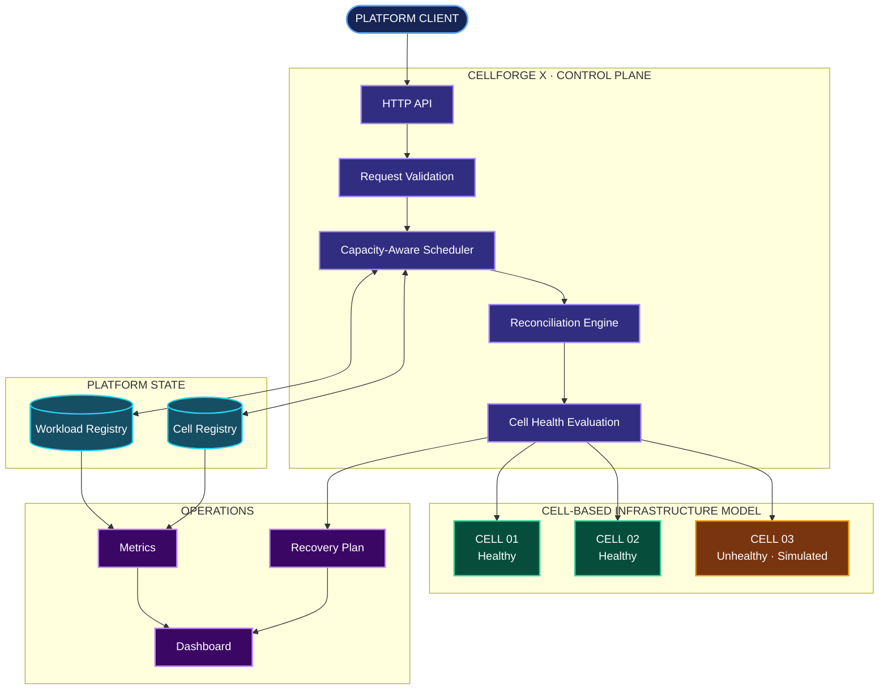
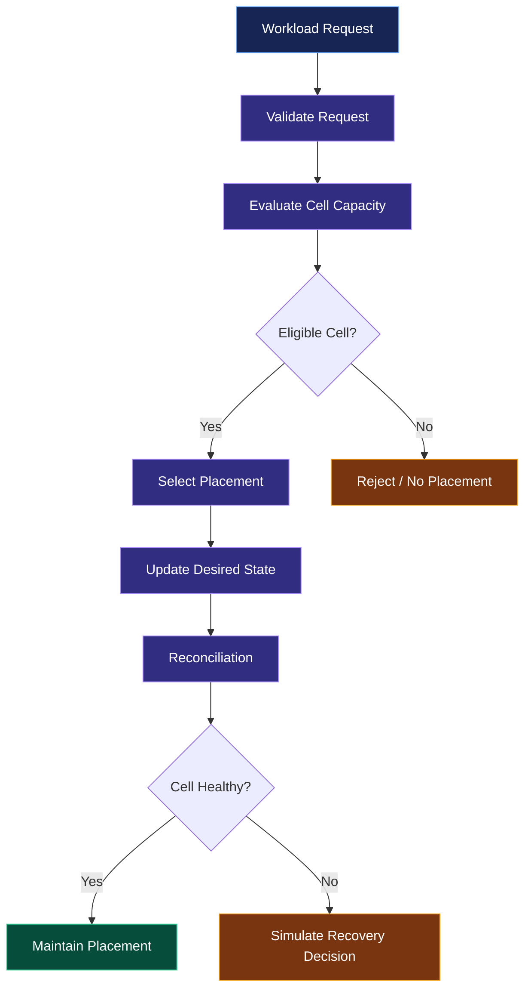

# CELLFORGE X

<div align="center">

### ADVANCED MULTI-CLUSTER KUBERNETES PLATFORM CONTROL PLANE

**Infrastructure, orchestrated intelligently.**

A Go-based platform engineering prototype exploring cell-based infrastructure, capacity-aware scheduling, workload reconciliation, and failure isolation.

<br/>

[](https://go.dev/)
[](https://kubernetes.io/)
[](https://www.docker.com/)
[](#)
[](LICENSE)

**[Repository](https://github.com/akankshad1712/cellforge-x-multi-cluster-platform) · [Architecture](docs/ARCHITECTURE.md) · [API Documentation](docs/API.md) · [Runbook](docs/RUNBOOK.md)**

</div>

---

## 01 / THE CONCEPT

Infrastructure platforms are not simply collections of clusters. They are systems that must make placement decisions, maintain state, respond to failures, and expose operational information.

**CELLFORGE X** explores these challenges through a cell-based control-plane design.

Its central architectural idea is failure containment: organize infrastructure into logical cells, evaluate their capacity and health, and model recovery decisions without treating every infrastructure failure as a platform-wide event.

### Design philosophy

| Principle | Engineering intent |
|---|---|
| Cell isolation | Limit the modeled blast radius of failures |
| Intelligent placement | Consider infrastructure capacity |
| Reconciliation | Compare desired and observed state |
| Recovery planning | Evaluate alternative placement decisions |
| Observability | Expose useful operational information |
| Modularity | Separate platform responsibilities |

## 02 / ARCHITECTURE

### System topology



### Architectural boundaries

| Component | Responsibility |
|---|---|
| API | Receives platform requests |
| Scheduler | Evaluates capacity and placement |
| State store | Maintains modeled platform state |
| Reconciliation | Generates corrective plans |
| Cell model | Represents isolated infrastructure units |
| Health evaluation | Evaluates cell health |
| Operations | Exposes metrics and dashboard information |

> **Architecture note:** This repository currently models cell-based infrastructure and simulated recovery. It does not yet implement live multi-cluster Kubernetes orchestration.

## 03 / ENGINEERING CAPABILITIES

| Capability | Implementation |
|---|---|
| Go control-plane API | Implemented |
| Capacity-aware scheduler | Implemented |
| Platform state model | Implemented |
| Reconciliation behavior | Prototype |
| Failure and recovery behavior | Simulation |
| Dashboard interface | Included |
| Docker packaging | Included |
| Kubernetes deployment assets | Included |
| GitHub Actions workflow | Included |
| Live multi-cluster connectivity | Planned |

### Scheduling lifecycle



## 04 / TECHNOLOGY SYSTEM

| Layer | Technology |
|---|---|
| Core language | Go |
| API | Go HTTP |
| Infrastructure concepts | Kubernetes |
| Packaging | Docker |
| Configuration | YAML |
| Automation | GitHub Actions |
| Interface | HTML, CSS, JavaScript |
| Observability concept | Prometheus-format metrics |

## 05 / REPOSITORY MAP

```text
cellforge-x-multi-cluster-platform/
│
├── .github/
│   └── workflows/
│       └── ci.yml
│
├── cmd/
│   └── controlplane/
│       └── main.go
│
├── internal/
│   └── platform/
│       ├── api.go
│       ├── model.go
│       ├── scheduler.go
│       ├── store.go
│       └── platform_test.go
│
├── deploy/
│   └── kubernetes/
│       └── deployment.yaml
│
├── docs/
│   ├── API.md
│   ├── ARCHITECTURE.md
│   ├── RUNBOOK.md
│   └── architecture.svg
│
├── scripts/
│   └── demo.sh
│
├── web/
│   └── dashboard.html
│
├── Dockerfile
├── Makefile
├── go.mod
├── LICENSE
└── README.md
```

## 06 / QUICK START

### Requirements

- Go toolchain
- Git
- VS Code or another Go editor

### Clone

```bash
git clone https://github.com/akankshad1712/cellforge-x-multi-cluster-platform.git

cd cellforge-x-multi-cluster-platform
```

### Dependencies

```bash
go mod download
```

### Run tests

```bash
go test ./... -race -cover
```

### Start the control plane

```bash
go run ./cmd/controlplane
```

### Open the dashboard

Open `web/dashboard.html` in your browser.

Refer to [docs/API.md](docs/API.md) for API documentation and [docs/RUNBOOK.md](docs/RUNBOOK.md) for operational guidance.

## 07 / PROJECT ROADMAP

These are potential future engineering extensions.

- [ ] Live Kubernetes integration using client-go or controller-runtime
- [ ] Persistent state using PostgreSQL
- [ ] Distributed coordination and leader election
- [ ] Topology-aware scheduling
- [ ] AWS and GCP provider adapters
- [ ] OpenTelemetry tracing
- [ ] Expanded Prometheus and Grafana observability
- [ ] Chaos engineering and fault injection
- [ ] Production authentication and authorization
- [ ] Integration and load testing

## 08 / ENGINEERING SCOPE

CELLFORGE X is an advanced engineering prototype intended to explore control-plane architecture.

The current implementation should not be confused with a production Kubernetes platform. Real cluster mutation, distributed coordination, persistent infrastructure state, cloud provisioning, and production security are not yet represented as completed capabilities.

This distinction is intentional: architecture, simulation, and implemented behavior should remain independently verifiable.

## 09 / AUTHOR

<div align="center">

### AKANKSHA DESHMUKH

**Software Engineering · Platform Engineering · Cloud-Native Infrastructure**

[](https://github.com/akankshad1712)

[](https://www.linkedin.com/in/akanksha-deshmukh-26210b244/)

</div>

---

<div align="center">

**CELLFORGE X**

*Beyond cluster management. Toward intelligent infrastructure orchestration.*

<sub>Designed and developed by Akanksha Deshmukh.</sub>

</div>
