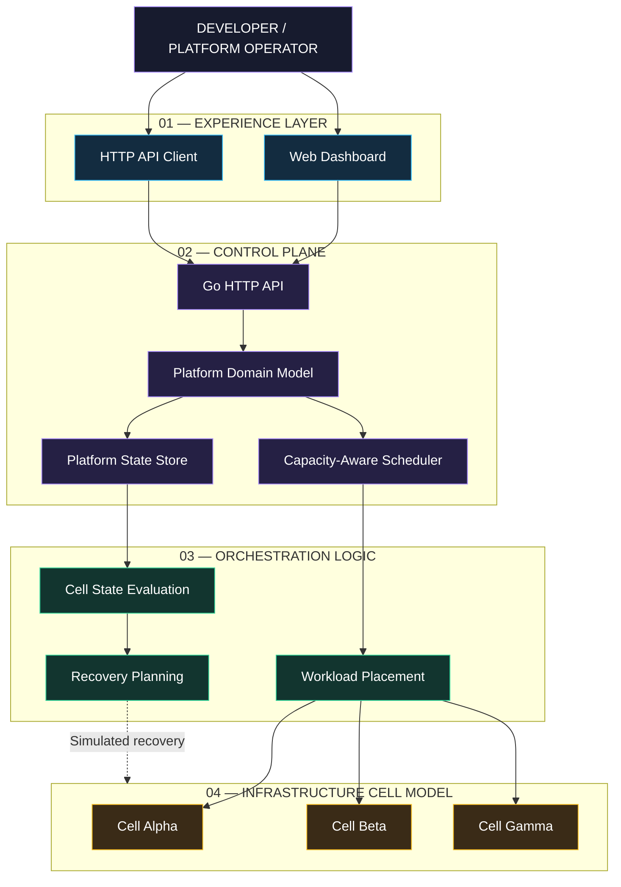
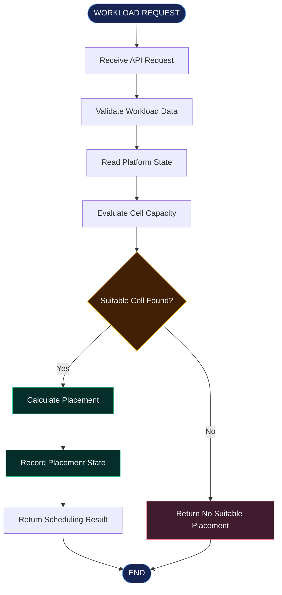

 <div align="center">

# ◈ CELLFORGE X

### MULTI-CLUSTER PLATFORM CONTROL PLANE

**One control plane. Multiple infrastructure cells. Intelligent workload orchestration.**

A Go-based platform engineering prototype exploring workload placement, capacity-aware scheduling, infrastructure state management, and recovery orchestration through a unified control-plane architecture.

<br/>


<br/>

[Architecture](docs/ARCHITECTURE.md) · [API Reference](docs/API.md) · [Operations Runbook](docs/RUNBOOK.md)

</div>

---

## 01 / THE CONCEPT

> **Infrastructure is distributed. Control should feel unified.**

CELLFORGE X models a centralized platform control plane that manages workload placement across multiple infrastructure cells.

Instead of treating infrastructure as a collection of disconnected environments, the platform introduces a unified model for:

- Workload registration and lifecycle management
- Capacity-aware scheduling decisions
- Infrastructure cell state management
- Placement and resource evaluation
- Recovery and failover simulation
- Operational visibility through a dashboard

The result is a focused engineering prototype demonstrating how platform orchestration systems can be structured.

---

## 02 / SYSTEM BLUEPRINT

### A layered control-plane architecture



**Architecture principle:** separate the user interface, API boundary, platform domain, scheduling logic, state management, and infrastructure model.

---

## 03 / CORE ENGINEERING MODULES

| Module | Responsibility |
|---|---|
| Control Plane API | HTTP interface for platform operations |
| Domain Model | Represents workloads and infrastructure state |
| Scheduler | Evaluates capacity-aware workload placement |
| State Store | Maintains platform state in the prototype |
| Recovery Logic | Models recovery and failover decisions |
| Dashboard | Provides a visual platform interface |
| Deployment Assets | Includes Docker and Kubernetes configuration |

### Workload orchestration lifecycle



---

## 04 / PLATFORM CAPABILITIES

### 01 — Intelligent placement

Capacity-aware scheduling logic evaluates modeled infrastructure capacity to determine suitable workload placement.

### 02 — Unified platform state

A centralized state model represents workloads, infrastructure cells, and scheduling-related information.

### 03 — Recovery orchestration

Recovery logic demonstrates how infrastructure state changes can inform recovery and failover planning.

### 04 — API-driven operations

A Go HTTP API provides the control-plane interface for platform operations.

### 05 — Visual operations interface

A browser-based dashboard presents the platform through a dedicated interface.

### 06 — Container and deployment assets

Docker and Kubernetes deployment configuration provide a containerization and deployment foundation.

---

## 05 / TECHNOLOGY STACK

| Layer | Technology |
|---|---|
| Core language | Go |
| API layer | Go HTTP |
| Platform architecture | Control-plane design |
| Scheduling | Capacity-aware scheduling logic |
| Containerization | Docker |
| Orchestration configuration | Kubernetes YAML |
| CI configuration | GitHub Actions |
| Frontend | HTML dashboard |
| Documentation | Markdown and Mermaid |
| Version control | Git and GitHub |

---

## 06 / REPOSITORY ARCHITECTURE

```text
CELLFORGE-X/
│
├── .github/
│   └── workflows/
│       └── ci.yml
│
├── cmd/
│   └── controlplane/
│       └── main.go
│
├── internal/
│   └── platform/
│       ├── api.go
│       ├── model.go
│       ├── scheduler.go
│       ├── store.go
│       └── platform_test.go
│
├── deploy/
│   └── kubernetes/
│       └── deployment.yaml
│
├── docs/
│   ├── API.md
│   ├── ARCHITECTURE.md
│   ├── RUNBOOK.md
│   └── architecture.svg
│
├── scripts/
│   └── demo.sh
│
├── web/
│   └── dashboard.html
│
├── .dockerignore
├── Dockerfile
├── go.mod
├── Makefile
├── LICENSE
└── README.md
```

### Code organization

- `cmd/` — application entry point
- `internal/` — platform implementation
- `deploy/` — Kubernetes deployment configuration
- `docs/` — technical documentation and architecture assets
- `scripts/` — demonstration utilities
- `web/` — dashboard interface

---

## 07 / GETTING STARTED

### Prerequisites

- Go installed
- Git installed
- Docker installed (for container workflows)

### Clone the repository

```bash
git clone https://github.com/akankshad1712/cellforge-x-multi-cluster-platform.git

cd cellforge-x-multi-cluster-platform
```

### Download Go dependencies

```bash
go mod download
```

### Run the application

```bash
go run ./cmd/controlplane
```

Use the configured application address and port when accessing the API. Refer to the implementation and `docs/API.md` for the available routes.

### Run tests

```bash
go test ./...
```

### Build the application

```bash
go build ./...
```

---

## 08 / CONTAINER WORKFLOW

Build the container image:

```bash
docker build -t cellforge-x:local .
```

Run the container using the port configured by the application:

```bash
docker run --rm -p 8080:8080 cellforge-x:local
```

If the application uses a different listening port, adjust the host-to-container port mapping accordingly.

---

## 09 / DEPLOYMENT CONFIGURATION

The repository includes a Kubernetes deployment manifest:

```text
deploy/kubernetes/deployment.yaml
```

Inspect and apply it to a configured Kubernetes environment:

```bash
kubectl apply -f deploy/kubernetes/deployment.yaml
```

The manifest provides deployment configuration. It does not, by itself, connect the prototype to live multi-cluster infrastructure.

---

## 10 / ENGINEERING SCOPE

| Capability | Project implementation |
|---|---|
| Go control-plane application | Included |
| HTTP API | Included |
| Platform domain model | Included |
| Capacity-aware scheduler | Included |
| Platform state management | Included |
| Recovery / failover logic | Simulation |
| Web dashboard | Included |
| Dockerfile | Included |
| Kubernetes deployment manifest | Included |
| GitHub Actions workflow | Included |

**Scope clarification:** CELLFORGE X is a working engineering prototype. Infrastructure cells and recovery behavior are modeled within the application; live multi-cluster provisioning, production cluster mutation, distributed coordination, and production-grade persistence are not claimed.

---

## 11 / TECHNICAL DOCUMENTATION

| Document | What it covers |
|---|---|
| [Architecture](docs/ARCHITECTURE.md) | System design and component relationships |
| [API Reference](docs/API.md) | API interface documentation |
| [Runbook](docs/RUNBOOK.md) | Operational guidance |
| [Architecture SVG](docs/architecture.svg) | Visual architecture asset |

---

## 12 / PROJECT DESIGN PHILOSOPHY

```text
                 CELLFORGE X
                      │
          ┌───────────┴───────────┐
          │                       │
     CONTROL PLANE           CELL MODEL
          │                       │
    API + DOMAIN            CAPACITY + STATE
          │                       │
     SCHEDULER              RECOVERY LOGIC
          │                       │
          └───────────┬───────────┘
                      │
              UNIFIED PLATFORM
```

**Design priorities**

- Clear separation of responsibilities
- Modular Go application structure
- Explicit platform domain modeling
- Capacity-aware decision logic
- API-first control-plane interaction
- Documented deployment assets
- Reproducible developer workflows

---

## 13 / AUTHOR

<div align="center">

### AKANKSHA DESHMUKH

**Aspiring Software Engineer | Platform Engineering | Cloud & DevOps**

Building practical engineering projects around cloud infrastructure, automation, distributed systems concepts, and modern software architecture.

[](https://github.com/akankshad1712)
[](https://www.linkedin.com/in/akanksha-deshmukh-26210b244/)

**CELLFORGE X — A platform engineering prototype built with Go.**

</div>

---

<div align="center">

<sub>Designed and documented by Akanksha Deshmukh · MIT License</sub>

**CONTROL THE PLATFORM. MODEL THE INFRASTRUCTURE. ORCHESTRATE WITH INTENT.**

</div>