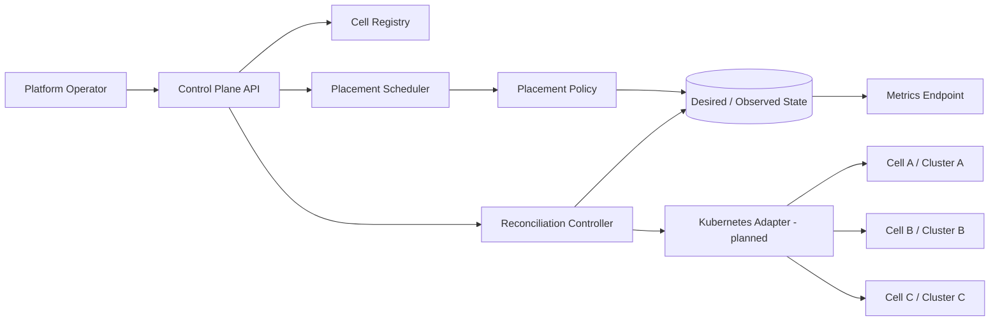

# Architecture

## Core invariants
- New placements target healthy cells only.
- A placement cannot exceed declared cell capacity.
- Scheduler tie-breaking is deterministic.
- Reconciliation can be called repeatedly for pending/disrupted workloads.
- The in-memory store serializes mutations within one process only.

## Production gaps
The current implementation is a single-process prototype with in-memory state. It does not yet operate real Kubernetes clusters. A production evolution requires durable state, Kubernetes client-go adapters, CRDs, optimistic concurrency/resource versions, leader election or partitioned queues, RBAC, audit events, topology spread, rate-limited retries, and integration/chaos tests.
